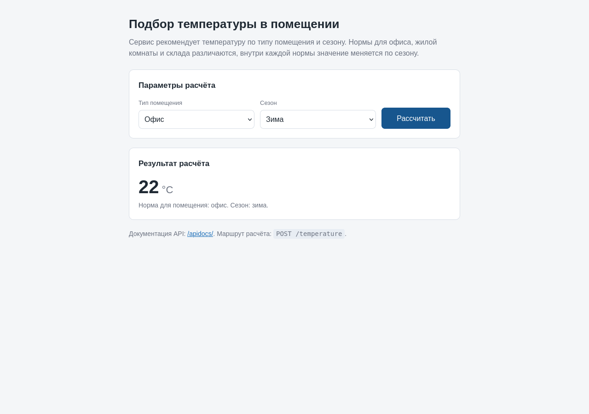
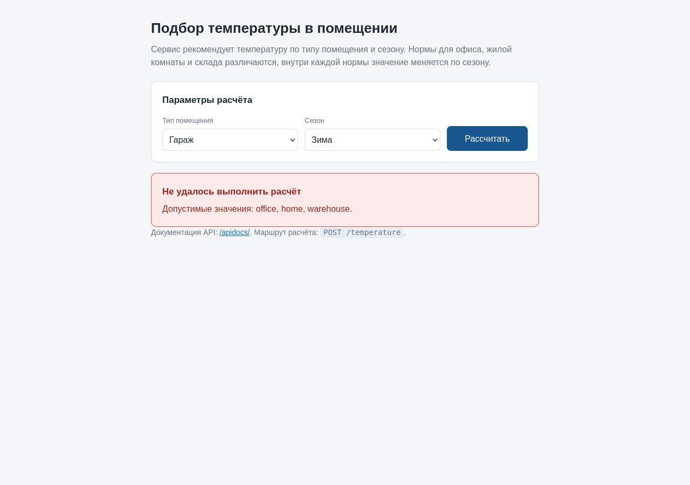
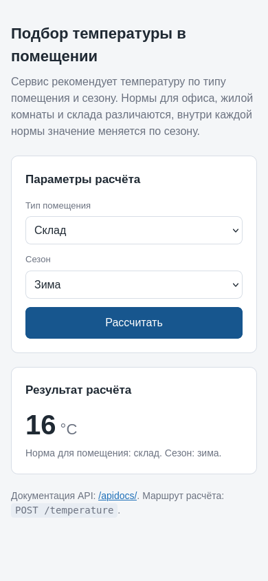
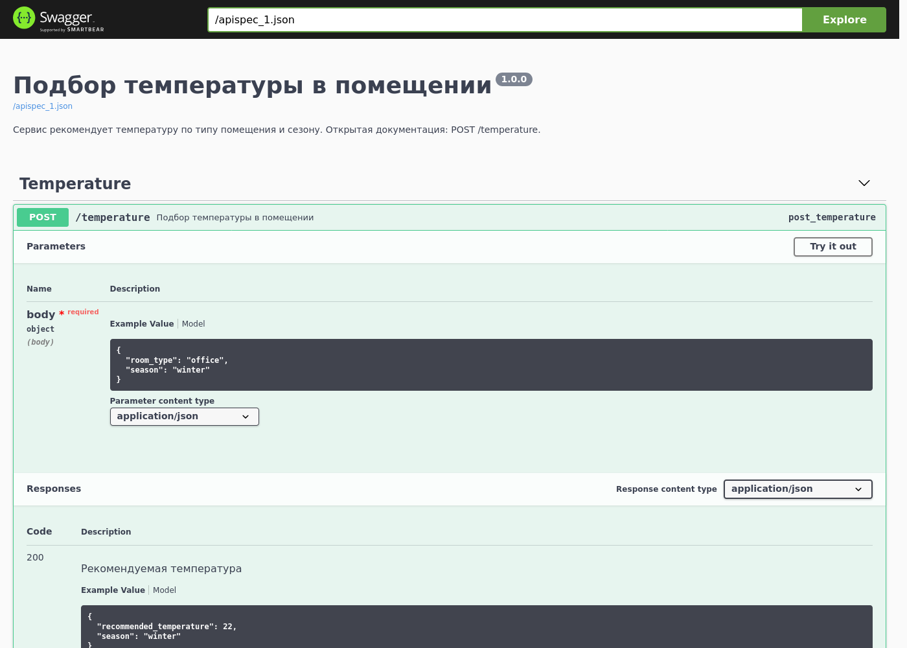

# Подбор температуры в помещении

HTTP-сервис рекомендует температуру по типу помещения и сезону. Решение принимает
сервер: для офиса, жилой комнаты и склада действуют разные нормы, а сезон сдвигает
значение внутри каждой нормы. У сервиса есть страница с формой: выбор помещения и
сезона, кнопка расчёта и ответ сервиса на той же странице.



## Что умеет

| Тип помещения | Зима | Весна | Лето | Осень |
| --- | --- | --- | --- | --- |
| `office` | 22 | 21 | 23 | 21 |
| `home` | 24 | 22 | 23 | 22 |
| `warehouse` | 16 | 14 | 18 | 14 |

Запрос:

```bash
curl -X POST http://127.0.0.1:9030/temperature \
  -H 'Content-Type: application/json' \
  -d '{"room_type": "office", "season": "winter"}'
```

Ответ:

```json
{"recommended_temperature": 22, "season": "winter"}
```

## Интерфейс

Страница на главном адресе сервиса: два списка, кнопка расчёта и блок результата.
Форма отправляет запрос на маршрут расчёта и показывает ответ, поэтому проверять
сервис можно без curl и без документации.

| Сценарий | Как выглядит |
| --- | --- |
| Расчёт для склада |  |
| Отказ при недопустимом значении |  |
| Узкий экран |  |

Интерактивная документация доступна на `/apidocs/`: описание эндпоинта, поля запроса
с примером и ответы с кодами.



## Стек

| Слой | Технологии |
| --- | --- |
| Приложение | Python 3.12, Flask 3 |
| Валидация и схемы | marshmallow |
| Документация API | flasgger (Swagger UI, адрес `/apidocs/`) |
| Страница | Jinja2 и небольшой скрипт на чистом JavaScript |
| Запуск | gunicorn, Docker Compose |
| Зависимости | Pipenv (`Pipfile`, `Pipfile.lock`) |
| Тесты | pytest, pytest-mock |

## Устройство

```
project/
├── src/
│   ├── app/
│   │   ├── main.py              # создание приложения, маршруты, обработчики ошибок
│   │   ├── schema.py            # схемы запроса, ответа и ошибки
│   │   ├── templates/base.html  # страница с формой расчёта
│   │   ├── service/
│   │   │   ├── main.py          # TemperatureAdvisor и три стратегии расчёта
│   │   │   ├── entities.py      # типизированные словари входа и выхода
│   │   │   ├── enums.py         # типы помещений и сезоны
│   │   │   ├── exceptions.py    # ServiceException и TemperatureException
│   │   │   ├── messages.py      # тексты сообщений
│   │   │   └── tests/           # тесты сервиса
│   │   └── tests/               # тесты API и схем
│   └── Pipfile
├── docker/                      # образ и compose для запуска под gunicorn
├── scripts/                     # up, start, stop, down, test
└── docs/
```

Расчёт построен на абстрактном классе `TemperatureAdvisor` и трёх наследниках:
`OfficeTemperature`, `HomeTemperature`, `WarehouseTemperature`. Класс выбирается по
типу помещения через карту стратегий, поэтому новый тип помещения добавляется одним
классом и одной строкой в карте, а таблицы норм лежат отдельно от логики.

## Быстрый старт

Нужен Python 3.12 или новее.

```bash
cd src
python -m venv .venv
. .venv/bin/activate
pip install flask marshmallow flasgger

PYTHONPATH=. python -m flask --app app.main run --port 9030
```

Сервис поднимется на `http://127.0.0.1:9030` со страницей расчёта, документация - на
`/apidocs/`. Каталог `src` попадает в путь импорта через `PYTHONPATH`: так же устроен
запуск в Docker и под gunicorn.

Через Pipenv:

```bash
cd src
pipenv install --dev
PYTHONPATH=. pipenv run python -m flask --app app.main run --port 9030
```

## Запуск в Docker

```bash
cd project
scripts/up        # сборка и запуск на порту 9030
scripts/stop      # остановка
scripts/down      # остановка с удалением контейнера
```

Контейнер запускает gunicorn на порту 9030, исходники монтируются только для чтения.
Число рабочих процессов задаётся переменной `GUNICORN_WORKERS`.

## API

| Метод | Адрес | Назначение |
| --- | --- | --- |
| GET | `/` | страница с формой расчёта |
| POST | `/temperature` | рекомендуемая температура по типу помещения и сезону |
| GET | `/apidocs/` | интерактивная документация Swagger |

Тело запроса:

| Поле | Тип | Обязательно | Допустимые значения |
| --- | --- | --- | --- |
| `room_type` | строка | да | `office`, `home`, `warehouse` |
| `season` | строка | да | `winter`, `spring`, `summer`, `autumn` |

Ответ 200: `recommended_temperature` (целое) и `season` (строка).

| Код | Причина | Тело ответа |
| --- | --- | --- |
| 400 | тело не объект JSON, пропущено поле, недопустимое значение, лишнее поле | `{"error": "ValidationError", "details": {...}}` |
| 404 | маршрут не найден | `{"error": "NotFound", "details": "Маршрут не найден."}` |
| 405 | метод не поддерживается | `{"error": "MethodNotAllowed", ...}` |
| 500 | ошибка расчёта или непредвиденный сбой | `{"error": "TemperatureException", "details": "..."}` |

Все ответы, включая ошибки маршрутизации, отдаются в формате JSON: клиенту не нужно
разбирать страницу HTML, чтобы понять причину отказа.

## Тесты

```bash
cd src
pipenv run pytest -v          # или: scripts/test
```

Сорок одна проверка: расчёт для всех двенадцати сочетаний типа помещения и сезона,
выбор стратегии по карте, собственное исключение для неизвестного типа, схемы запроса
и ответа, коды 400 для пустого тела, не-объекта JSON, пропущенного и недопустимого
поля, лишнего поля, коды 404 и 405 в формате JSON, код 500 при непредвиденной ошибке
расчёта.

Без Pipenv тот же прогон: `PYTHONPATH=. python -m pytest -q`.

## Ограничения

Нормы температуры заданы таблицей в коде: значения меняются правкой карты, а не
настройками. Типы помещений и сезоны фиксированы перечислениями, и такие же списки
продублированы в разметке формы: новый тип помещения добавляется в двух местах.
Аутентификации нет, сервис рассчитан на локальный запуск. Зависимости закреплены через
Pipenv; для установки без Pipenv в README приведён список из трёх пакетов.

## Лицензия

MIT, см. `LICENSE`.
